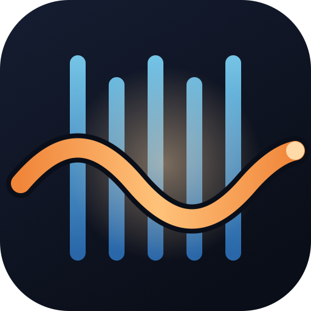
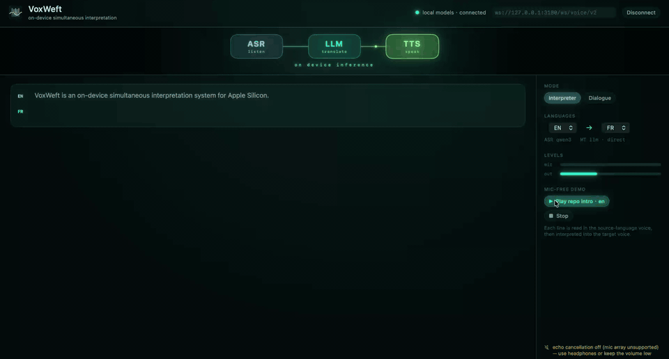
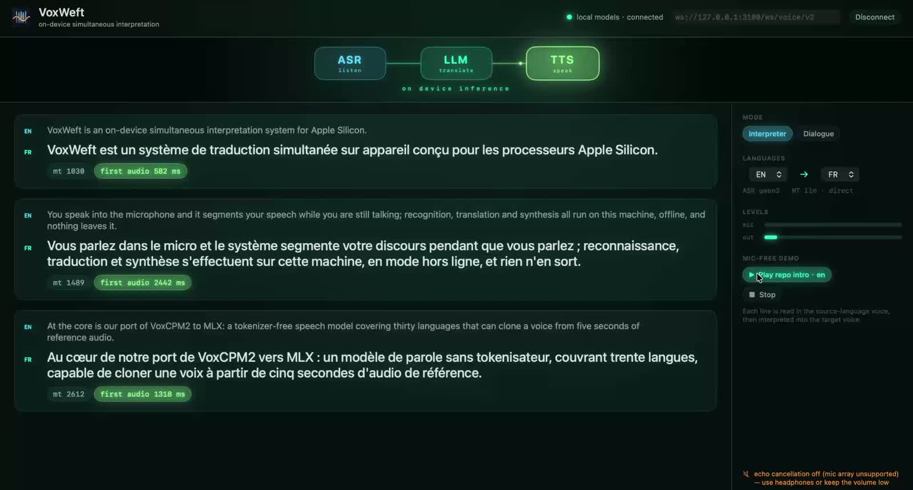
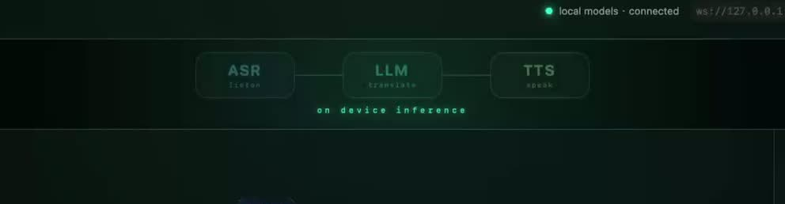

<p align="center">
  
</p>

<h1 align="center">VoxWeft</h1>

<p align="center">
  <b>On-device simultaneous interpretation on Apple Silicon.</b><br>
  Speech in, translated speech out, streaming — nothing leaves the machine.
</p>

<p align="center">
  <a href="LICENSE"></a>
  
  
  
  
  
</p>

<p align="center">
  
</p>

<p align="center"><sub>English → French on a MacBook (M5), no microphone: each line is read in a designed source voice, then interpreted into the target voice. The dashboard glows with whichever model is working. Full clip: <a href="docs/media/showcase.mp4">docs/media/showcase.mp4</a> (70 s, 1.6 MB).</sub></p>

---

At the core is our port of [VoxCPM2](https://github.com/OpenBMB/VoxCPM) —
a 2B tokenizer-free TTS covering 30 languages — to [MLX](https://github.com/ml-explore/mlx):
zero weight conversion for the LM, bit-exact AudioVAE, a **stateful streaming
decoder** that gets first audio out in ~170 ms on an M5, ~300 ms on a base M2,
~150 ms on M3 Ultra; voice cloning from ~5 s of reference audio; 4-bit
quantization. Verified module-by-module against the official PyTorch
implementation.

Around it: a runtime that turns a microphone into segmented, translated,
spoken output while the speaker is still talking — and a macOS shell that
shows you which model is working, and how long each step took.

There is no PyPI or npm package, on purpose: the source is the distribution.
Clone, install editable, point your agent at the clone.

```bash
git clone https://github.com/HenryZ838978/VoxWeft && cd VoxWeft
python -m venv .venv && source .venv/bin/activate
pip install -e .              # L1: TTS, clone, `voxweft say`
pip install -e ".[mcp]"       # + MCP server for agent harnesses
pip install -e ".[runtime]"   # + segmenter, ASR/LLM adapters, WebSocket server
```

If you are an agent (Claude Code, Codex, Cursor, …) setting this up for a
user, read [`docs/AGENT-SETUP.md`](docs/AGENT-SETUP.md) — it is written for you.

---

## Three layers, one repo

```
              ┌──────────────────────────────────────────────────────┐
   L3         │  CLI  ·  MCP server  ·  macOS shell (app/)           │  wrappers — thin, replaceable
              └──────────────────────────────────────────────────────┘
              ┌──────────────────────────────────────────────────────┐
   L2         │  segmenter / endpointing  →  ASR  →  MT | LLM        │  runtime — MLX only,
   runtime    │  language router · orchestrator · /ws/voice/v2       │  models are yours to pick
              └──────────────────────────────────────────────────────┘
              ┌──────────────────────────────────────────────────────┐
   L1         │  VoxCPM2 on MLX: streaming VAE · clone · 4-bit       │  core — ours end to end
   core       │  `voxweft say`                                       │
              └──────────────────────────────────────────────────────┘
```

**L1 is the reason this repo exists.** It is complete, tested against
goldens, and useful on its own — any agent harness can get a local voice
through the MCP server in one JSON block.

**L2 is Lego.** We ship two defaults each for ASR and LLM and the adapters to
plug them in, but you download the weights. Everything runs on MLX; we do not
support Ollama or other CPU-first runtimes because they cannot hit the
latency budget on this hardware.

**L3 is whatever fits.** CLI, MCP, and a ~700-line SwiftUI shell in `app/`
with hold-to-talk, a live ASR → LLM → TTS dashboard, per-turn latency chips
and a mic-free demo. Disposable by design.

<p align="center">
  
</p>
<p align="center"><sub>Each card is one segment: source line, interpretation, and what it cost — <code>mt</code> is the LLM, <code>first audio</code> is measured from the moment the text reached VoxCPM2 to the first sample the speaker played.</sub></p>

## Quick start — L1

```bash
export VOXCPM2_MODEL=~/.voxweft/models/VoxCPM2      # see docs/MODELS.md
python scripts/convert_vae.py $VOXCPM2_MODEL        # one-time, audiovae.pth → MLX

voxweft say "你好，欢迎使用语音合成服务。" --play
voxweft say "Guten Morgen, wie geht es Ihnen?" --stream -o out.wav   # prints first-audio ms
voxweft say "ສະບາຍດີທຸກໆທ່ານ" --ref my_voice.wav -o lao.wav          # clone from ~5 s
```

```python
from voxweft.core import VoxCPM2Pipeline

pipe = VoxCPM2Pipeline(model_dir, inference_timesteps=6, quantize_lm=4)
for chunk, i in pipe.generate_streaming("text", ref_latents=pipe.encode_reference(ref_16k)):
    play(chunk)                       # float32 @ 48 kHz
```

MCP, for Claude Code / Codex / Cursor / anything that speaks MCP — point the
harness at the venv inside your clone, no global install. Works with the
`mcp` Python SDK 1.x and 2.x (2.x renamed `FastMCP`; the server adapts):

```jsonc
{"mcpServers": {"voxweft": {
    "command": "/path/to/VoxWeft/.venv/bin/voxweft", "args": ["mcp"],
    "env": {"VOXCPM2_MODEL": "/path/to/models/VoxCPM2"}}}}
```

## Quick start — L2 runtime

Two processes. The **bridge** owns the MLX models for TTS and ASR, each pinned
to its own thread (MLX GPU streams are thread-bound — see the devlog). The
**server** owns segmentation, routing, the in-process MLX LLM/MT, and the
WebSocket.

```bash
pip install -e ".[runtime]"
export VOXWEFT_MODEL_DIR=~/.voxweft/models         # VoxCPM2/, Qwen3-ASR-1.7B-8bit/, <llm>/
export VOXWEFT_LLM_DIR=$VOXWEFT_MODEL_DIR/Qwen3-4B-Instruct-2507-4bit
export VOXWEFT_VOICE_DIR=samples/voices          # <lang>_tgt.wav → the interpreter's voice per target language

voxweft bridge --port 8133 &      # wait for GET /ready → 200
voxweft serve  --port 3100        # ws://localhost:3100/ws/voice/v2
```

Protocol is in the docstring of `voxweft/runtime/server.py`: `session_config`,
`ptt_start`, int16 PCM frames, `ptt_end`; back come `asr`, `translation`,
`audio_start` + 48 kHz PCM chunks + `audio_end`, `turn_end`, and `no_speech`
with the measured level when nothing was cut.

### Default models

| slot | default | alt | licence |
|---|---|---|---|
| TTS | VoxCPM2 (4-bit) | — | Apache-2.0 |
| ASR | Qwen3-ASR-1.7B **8-bit** via mlx-audio (zh/en/vi/th/id/ms + 20 more) — 2.5 GB, RTF 0.11, transcripts identical to bf16 on our set | bf16 (4.1 GB) · 0.6B | Apache-2.0 |
| ASR, lo/km/my | whisper-large-v3-turbo (MLX) — routed automatically; **quality is poor** (Lao often comes back in Thai script) | Omnilingual-ASR CTC via sherpa-onnx is the better open option (adapter not written yet) | MIT |
| LLM / MT | Qwen3-4B-Instruct (mlx-lm) | Qwen3-8B · Hy-MT2-1.8B | Apache-2.0 |
| MT fallback | NLLB-200-1.3B | — | **CC-BY-NC-4.0**, opt-in, research only |

No model weights are in this repo. `docs/MODELS.md` has download notes
(ModelScope mirrors where HF is slow).

## What the runtime does that a model download doesn't

* **Cuts while you speak.** Per-frame RMS with an adaptive noise floor,
  0.45 s silence rule, forced cut at the first ≥100 ms dip after 6 s (hard cut at 9 s), and a *carry* buffer so a
  0.4 s "So," is prepended to the next segment instead of silently dropped.
  Learned end-of-turn (SmartTurn v3) is wired in and **off by default** — we
  measured it net-negative for interpretation and say why.
* **Routes by language pair, no pivot.** Any pair goes straight through the
  LLM — es→ms, de→vi, ja→fr are one hop, never via Chinese or English.
  Only low-resource *targets* (lo/km/my) go to dedicated MT, because a 4B
  chat model guesses the wrong script when asked to *write* them.
* **Keeps MLX alive under concurrency.** Thread-pinned executors, no locks
  across `yield`, warm-up through the same code path as requests. Each of
  those is a crash we had.
* **Interrupt actually interrupts.** `ptt_start` or Stop cuts the client
  stream, cancels the in-flight turn, and shuts the socket to the TTS so the
  bridge stops synthesizing within one patch — next sentence in ~1 s on M2
  instead of queuing 20 s behind a dead one.
* **Reports failure loudly.** A press with no segment returns
  `no_speech {peak_rms, threshold, too_quiet}` so "nothing said" and "too
  quiet" can be told apart on the spot instead of in the server log.

## Numbers

Measured on a base **M2 16 GB** with nothing else running (Lark, VPN helpers
and stray Python killed first — with them resident the same pipeline was
3–4× slower and free memory was ~100 MB). M3 Ultra figures from the stage
build.

| stage, in isolation | M2 16 GB | M5 16 GB (MacBook) | M3 Ultra |
|---|---|---|---|
| VoxCPM2 4-bit TTS, first audio (warm) | 303 ms | **169 ms** | 124–168 ms |
| VoxCPM2 4-bit TTS, RTF | **1.47** | 0.94 (with a full desktop session running) | ≈ 0.2 |
| Qwen3-ASR-1.7B 8-bit, 10 s clip | 1.2 s (RTF 0.11) · bf16: RTF 0.24 | — | — |
| Qwen3-4B 4-bit, one sentence zh→en | first token 405 ms · 16 tok in 870 ms | — | — |
| resident memory, all three | **6.7 GB** (bf16 ASR: 8.5) | 6.7 GB | — |

| end to end, `/ws/voice/v2` | M2 16 GB | M5 16 GB | M3 Ultra |
|---|---|---|---|
| text → LLM → first interpreted audio, per sentence (the clip above, en→fr) | — | **0.58 / 2.4 / 1.3 s** | — |
| segment commit → first interpreted audio (worker idle) | ≈ 2.5 s | — | ≈ 0.85 s |
| per-segment wall time, 5 s of speech out | ≈ 7 s | ≈ 5 s | ≈ 1.5 s |
| TTS ASR-round-trip CER, repo intro zh / en | 3.4% / 7.8% | | |
| segmenter, phone mic, ASR CER fixed→adaptive threshold | 16.3% → 10% | | |

On the M2 the pipeline is **TTS-bound**: RTF 1.47 means 5 s of speech takes
7 s to produce, and the serial worker makes the next segment wait. ASR and
the LLM together are ~1.5 s and would keep up with real time; the TTS is the
silicon ceiling (upstream measures the same RTF). On M3 Ultra all three are
under real time and the pipeline streams.

We do **not** publish BLEU. Translation quality is the property of the model
you plug in; what this repo owns is that the pipeline does not lose it on
the way: ASR-round-trip intelligibility of the TTS, first-audio latency, and
RTF. `bench/` has the scripts.

## Voices

No reference recordings ship. The showcase voices are *designed*: VoxCPM2's
caption mode (`(A mature man in his fifties, calm broadcaster voice, Castilian
Spanish)…`) generates candidates, a human picks one per language and role,
and the pick becomes the clone reference the bridge uses for that target
language. Convention: source speaker = mature male, interpreter = young
female, same text in every language — the repo's own two-sentence
introduction.

22 voices ship in `samples/voices/` (11 languages × src/tgt) and are
registered in `voxweft.db` — a single SQLite file that is the runtime's
default configuration: voices, the intro text per language, and the showcase
route matrix. The bridge installs every voice from it at start-up; nothing to
configure. `python -m voxweft.db show` dumps it.

To design your own:

```bash
python scripts/design_voices.py --langs de,fr --n 3 --out /tmp/cands
# listen, mark "pick": true in /tmp/cands/manifest.json, then
python scripts/pick_voices.py /tmp/cands && cp /tmp/cands/*_{src,tgt}.wav samples/voices/
python -m voxweft.db build
```

`samples/voices/<lang>_src.wav` is also the microphone stand-in for demos:
`scripts/mock_interpret.py --wav samples/voices/es_src.wav --src es --tgt ms`
streams it through the real PTT path at real-time pace — segmenter, ASR,
MT, TTS — with no microphone.

## The devlog is part of the product

[`docs/DEVLOG.md`](docs/DEVLOG.md) — every failure we hit, what we were wrong
about, and what it cost: MLX stream thread binding, a lock held across an
async `yield` that froze the process, `temperature` that is not a
temperature, text that the model dutifully read aloud, SwiftPM "building" in 2.8 s
without compiling, SwiftUI `Button` aborting on macOS 26, a learned
endpointer that made interpretation worse. A working demo can be
regenerated by any model; this list cannot.

## Layout

<p align="center"></p>

```
voxweft/
  core/        model.py · vae.py · generate.py · cli.py          L1
  runtime/     segmenter · router · orchestrator · translator     L2
               bridge.py (TTS+ASR HTTP) · server.py (WebSocket)
  wrappers/    mcp_server.py                                      L3
app/           SwiftUI macOS shell (hold-to-talk, latency chips, demo)  L3
tests/         golden alignment (needs model) · segmenter · router · orchestrator (no model)
bench/         asr / mt / tts benches + ASR-round-trip judge
scripts/       convert_vae.py · probe_{onset,stream,clone,perf}.py · mock_interpret.py
docs/          DEVLOG.md · TTS-FINDINGS.md · ARCHITECTURE.md · HARDWARE.md · MODELS.md
samples/       zero-shot zh / lo output, round-trip verified
```

## Credits

- [OpenBMB/VoxCPM](https://github.com/OpenBMB/VoxCPM) — the model. Tokenizer-free
  turned out to be exactly right for low-resource languages: no RVQ codebook
  to be out-of-distribution on.
- [ml-explore/mlx](https://github.com/ml-explore/mlx) — the array framework
  that made the port a one-day job (and the debugging a two-week one).
- Qwen3-ASR, mlx-lm, mlx-audio, pipecat SmartTurn — the Lego.

Apache-2.0.
